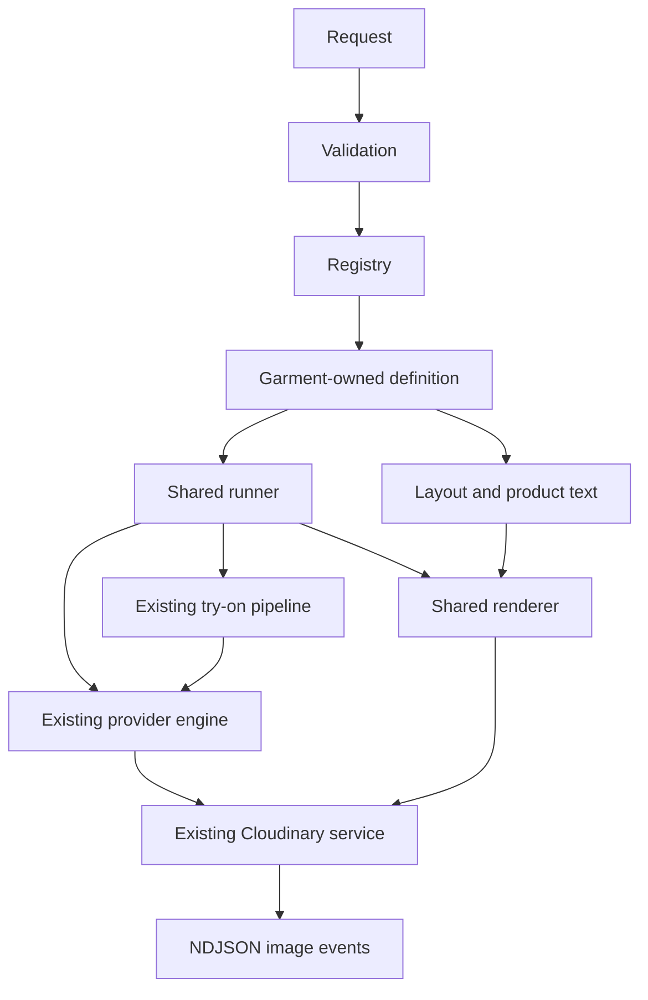

# Extensible garment catalogs

The shared runner and renderer execute explicit definitions, not garment-name
conditions. The HTTP endpoint is in `fabricapp/catalog.py`; it validates the
request, acquires a process slot, owns detached uploads and streams worker events.
It is intentionally separate from garment prompt construction and image layout.

## Ownership

- `catalog_engine/contracts.py`: immutable Shot, Panel, Text, Layout and
  CatalogDefinition values. Each definition provides shot configuration and layout
  functions, allowed product fields and optional garment request validation.
- `catalog_engine/registry.py`: explicit (garment, edition) allowlist and defaults.
  Client text never becomes a module path or filesystem path.
- `catalog_engine/validation.py`: unique IDs, ordered dependencies, identity source,
  asset/font availability, panel mapping, bounds and image-panel overlap checks.
- `catalog_engine/runner.py`: sequential execution, dependency readiness, provider
  calls, original-byte uploads, progress, partial failures, cancellation and collage.
- `catalog_engine/renderer.py`: generic proportional image fitting, text sizing,
  rules and PNG export. It has no garment checks and makes no network calls.
- `ai/garments/shirt/catalog/`: six-shot plan, unchanged shirt prompt wording and
  native front/panel geometry. Private pipeline framing now comes from its definition.
- `ai/garments/saree/catalog/`: seven-shot template/identity plan, isolated saree
  prompts, reference mappings and editorial header/footer layout.
- `catalog_engine/legacy.py`: explicitly retained six-shot compatibility editions
  for unmigrated garments. Their general prompts no longer contain shirt hem rules.
  Migrate each to its garment package when it needs custom behavior.

## Operations and dependencies

`pipeline` calls the existing public single-image coordinator with a declared
camera view and server-only framing options. `anchor_edit` uses the first declared
dependency as the source, with a declared scenario. `template_edit` uses the
registered reference file. An optional identity source is either `request` or a
declared dependency; the existing pose-reference provider route supports template,
fabric and identity in its three image slots.

Dependencies are based on successful generation, not successful delivery upload.
All edition shots are currently required for collage composition. Individual
successful uploads survive later shot or collage failures. Images are generated
sequentially; the implementation deliberately does not introduce parallel paid
calls, persistent jobs or an arbitrary plugin loader.

## Adding an edition

1. Create `ai/garments/<garment>/catalog/` with definition, prompts, layout and
   reference mappings. Reuse the garment's existing single-image builder for
   pipeline shots; do not copy it into the catalog engine.
2. Declare ordered shots, explicit operations/dependencies, template roles and
   framing. Declare provider dimensions in garment configs and keep them aligned.
3. Return a Layout mapping every shot key to a rectangle. Swatch placement is
   optional. Put product-specific facts in validated request metadata.
4. Register an explicit edition and, if desired, change that garment's default.
5. Add preflight, request/stream, failure and panel tests. The extension test renders
   an eight-panel definition without changing shared runner or renderer code.

A new garment also needs the application's existing garment/serializer/builder
registration. A new edition for an existing garment uses this catalog registry.
A genuinely new provider operation may require a deliberate shared engine change.

## Compatibility and references

The old `pipeline/catalog_prompts.py`, `images/catalog_collage.py` and
`references/catalog_reference.py` exports remain compatibility facades for existing
tools. Runtime execution uses explicit definitions and layouts. No shirt-layout
inference by view name is used by the runner. Single-image garment/pose behavior
and original pose assets are preserved. Catalog assets have their own copies and
SHA-256 provenance manifest. The serif font is bundled with its SIL OFL license.

Header/footer recomposition can run locally from saved photographs with
`tools/preview_catalog.py --shots-dir PATH`; it performs no AI call or upload.
Reference-only previews demonstrate placement and typography, not generated
cross-view consistency. Synthetic-provider tests establish plumbing and failure
behavior only. Live saree output still needs visual evaluation.
