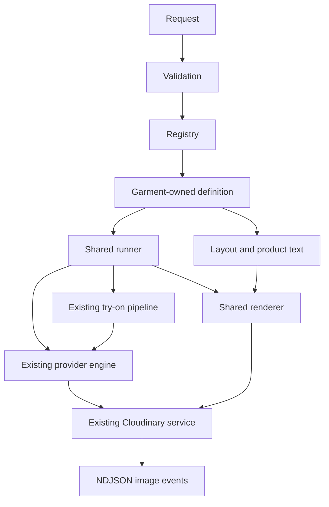

# Current saree layout revision

The default saree edition now declares six shots and an image-only 9:16 layout
(`saree-six-panel-9x16-v3`). It uses six numbered replacement assets. Its Layout has
no Text, lines, header/footer area or swatch rectangle. The frontend product fields
are removed; old metadata can be accepted without drawing anything.

The shared runner/renderer did not need garment conditions to make this change.
Only the saree definition, reference mapping, prompt/framing and layout changed.
The old catalog-only assets were deleted; normal pose assets remain separate.
Back-pallu still shares the normal prompt builder, but now edits the supplied
`03_back_view.png` and continues to forbid every separate identity input. All six shots edit their own templates independently. Side uses its new
three-quarter reference directly instead of copying a generated front pose. Shot counts come from definitions and stream metadata.

All panels use proportional cover fitting because the supplied numbered images
are already cropped to their intended panel shapes. The target has one full-height
left panel, two middle panels, three right panels and narrow white gutters.
See `docs/catalog.md` for the current contract. The sections below describe the
shared architecture and previous implementation history where explicitly noted.

---

# Extensible garment catalogs

The shared runner and renderer execute explicit definitions, not garment-name

conditions. The HTTP endpoint is in `fabricapp/catalog.py`; it validates the

request, acquires a process slot, owns detached uploads and streams worker events.

It is intentionally separate from garment prompt construction and image layout.

## Ownership

- `catalog_engine/contracts.py`: immutable Shot, Panel, Text, Layout and

  CatalogDefinition values. Each definition provides shot configuration and layout

  functions, allowed product fields and optional garment request validation.

- `catalog_engine/registry.py`: explicit (garment, edition) allowlist and defaults.

  Client text never becomes a module path or filesystem path.

- `catalog_engine/validation.py`: unique IDs, ordered dependencies, identity source,

  asset/font availability, panel mapping, bounds and image-panel overlap checks.

- `catalog_engine/runner.py`: sequential execution, dependency readiness, provider

  calls, original-byte uploads, progress, partial failures, cancellation and collage.

- `catalog_engine/renderer.py`: generic proportional image fitting, text sizing,

  rules and PNG export. It has no garment checks and makes no network calls.

- `ai/garments/shirt/catalog/`: six-shot plan, unchanged shirt prompt wording and

  native front/panel geometry. Private pipeline framing now comes from its definition.

- `ai/garments/saree/catalog/`: seven-shot template/identity plan, isolated saree

  prompts, reference mappings and editorial header/footer layout.

- `catalog_engine/legacy.py`: explicitly retained six-shot compatibility editions

  for unmigrated garments. Their general prompts no longer contain shirt hem rules.

  Migrate each to its garment package when it needs custom behavior.

## Operations and dependencies

`pipeline` calls the existing public single-image coordinator with a declared

camera view and server-only framing options. `anchor_edit` uses the first declared

dependency as the source, with a declared scenario. `template_edit` uses the

registered reference file. `crop` derives a panel from an earlier generated image

using normalized crop bounds, records source provenance and makes no AI call. An optional identity source is either `request` or a

declared dependency; the existing pose-reference route supports template, fabric and identity. An

optional fourth composition guide has its own declared crop; saree side guidance

excludes the template face. Identity crops apply only to the known centered front

anchor and are not automatic face detection.

Dependencies are based on successful generation, not successful delivery upload.

All edition shots are currently required for collage composition. Individual

successful uploads survive later shot or collage failures. Images are generated

sequentially; the implementation deliberately does not introduce parallel paid

calls, persistent jobs or an arbitrary plugin loader.

## Adding an edition

1. Create `ai/garments/<garment>/catalog/` with definition, prompts, layout and

   reference mappings. Reuse the garment's existing single-image builder for

   pipeline shots; do not copy it into the catalog engine.

2. Declare ordered shots, explicit operations/dependencies, template roles and

   framing. Declare provider dimensions in garment configs and keep them aligned.

3. Return a Layout mapping every shot key to a rectangle. Swatch placement is

   optional. Put product-specific facts in validated request metadata.

4. Register an explicit edition and, if desired, change that garment's default.

5. Add preflight, request/stream, failure and panel tests. The extension test renders

   an eight-panel definition without changing shared runner or renderer code.

A new garment also needs the application's existing garment/serializer/builder

registration. A new edition for an existing garment uses this catalog registry.

A genuinely new provider operation may require a deliberate shared engine change.

## Compatibility and references

The old `pipeline/catalog_prompts.py`, `images/catalog_collage.py` and

`references/catalog_reference.py` exports remain compatibility facades for existing

tools. Runtime execution uses explicit definitions and layouts. No shirt-layout

inference by view name is used by the runner. Single-image garment/pose behavior

and original pose assets are preserved. Catalog assets have their own copies and

SHA-256 provenance manifest. The serif font is bundled with its SIL OFL license.

Header/footer recomposition can run locally from saved photographs with

`tools/preview_catalog.py --shots-dir PATH`; it performs no AI call or upload.

Reference-only previews demonstrate placement and typography, not generated

cross-view consistency. Synthetic-provider tests establish plumbing and failure

behavior only. Live saree output was visually reviewed with one blue floral swatch and the Anaya

face: 14 actual generations, with consistent fabric input hashes. Final composition

uses six real photographs and a derived pallu edge crop. See

`docs/saree_catalog_live_evidence.json` and the current catalog API notes for limits.

## Reference and portrait correction

Back-pallu now calls the normal saree pose-reference builder for

`back_showing_pallu`; the catalog no longer has a competing generic back prompt.

This shot sends only pose reference + fabric, never a face choice/upload, uploaded

person or front anchor. Pose metadata, API validation, coordinator and provider

checks enforce that rule. It is independent of front generation. The ordinary

person-photo pose descriptions also contain concrete spatial instructions rather

than placeholder text.

Side-border now uses its own side-edge template generation, replacing the previous

body-print crop. It distinguishes the narrow continuous side edge from the body

and pallu/end panel. An unseen decorative product border cannot be inferred from

a body-only swatch; the requested fallback is a plain finished selvedge.

All default layouts export 9:16. Saree reflows to 1800×3200; shirt retains native

photo dimensions, centered in 1296×2304. Output metadata records width, height and

aspect_ratio and the UI displays the actual export ratio. Back-pallu and border

are contained proportionally so the edge is not cut off in the final collage.
